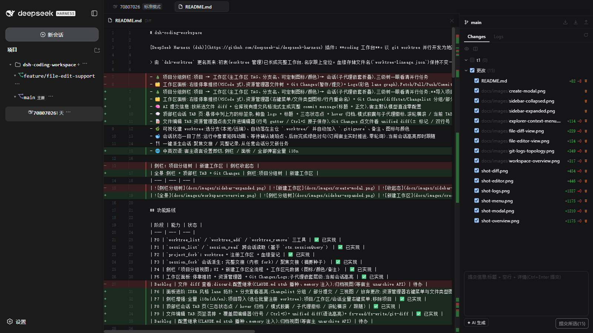
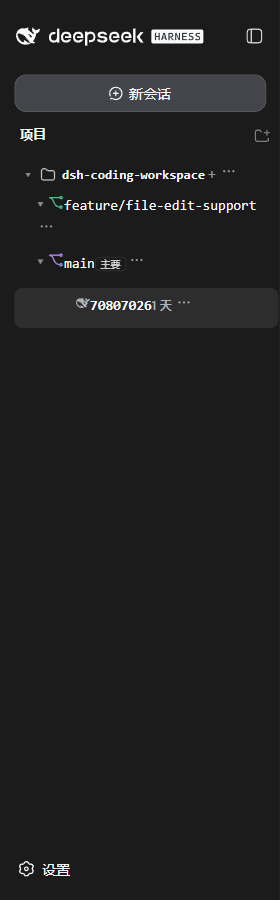
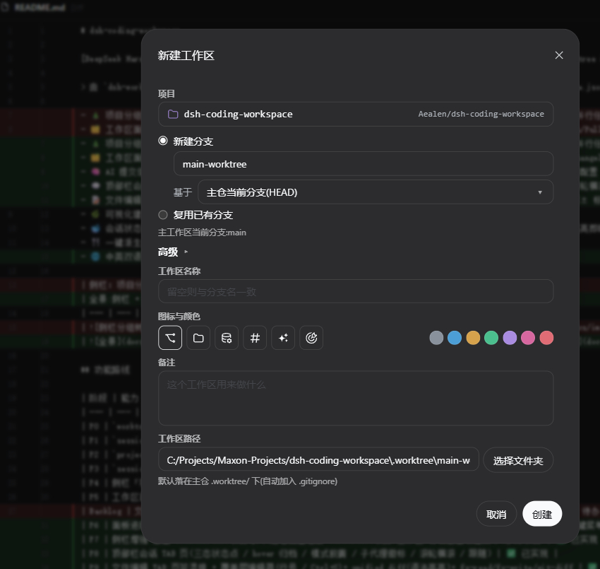
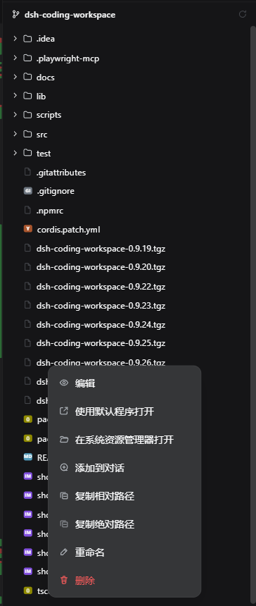
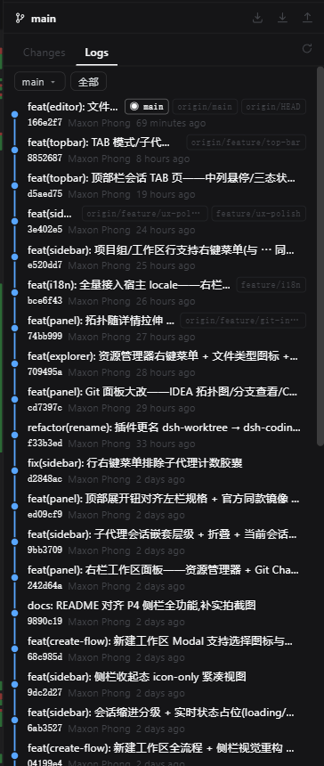
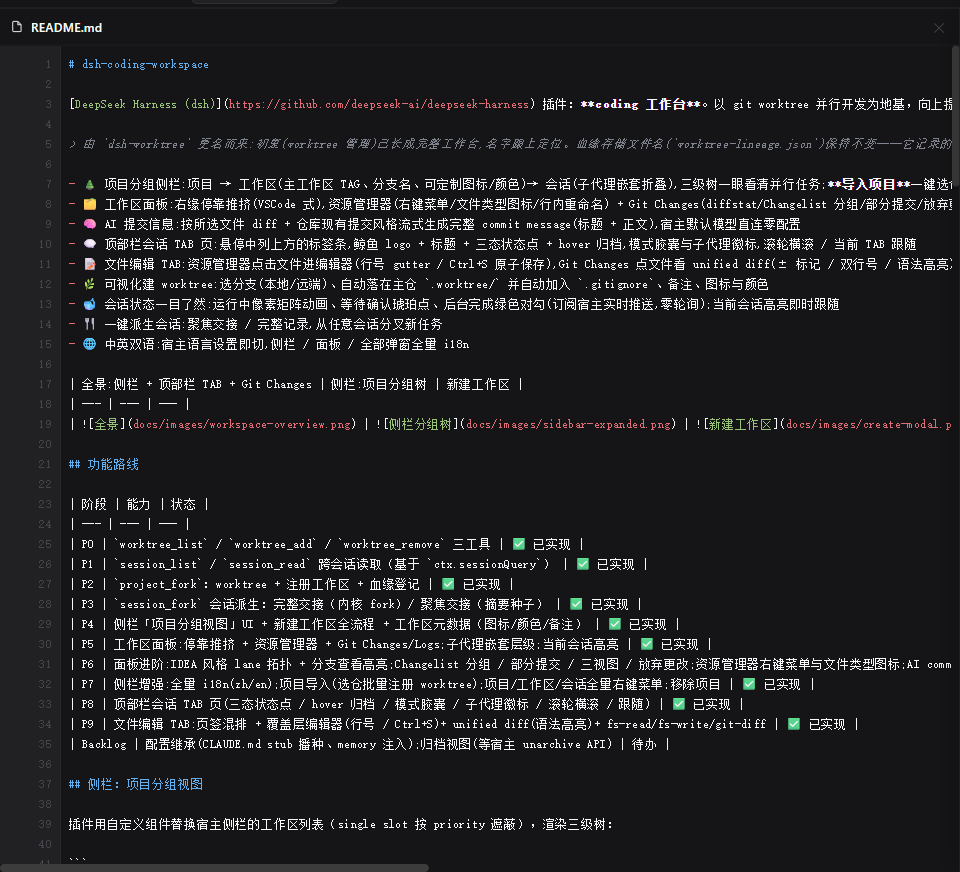
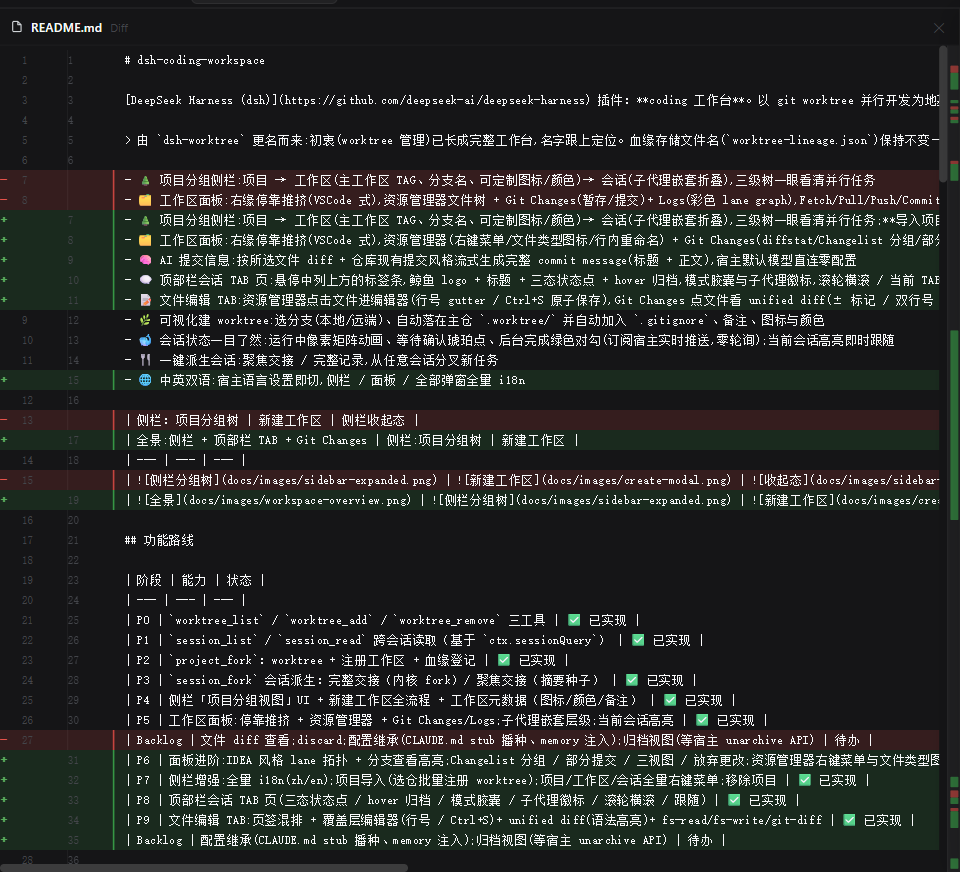

# dsh-coding-workspace

> 🌏 English documentation: [README.en.md](README.en.md)

[DeepSeek Harness (dsh)](https://github.com/deepseek-ai/deepseek-harness) 插件：**coding 工作台**。以 git worktree 并行开发为地基，向上提供**跨会话协作**原语、**项目分组侧栏**与**右侧栏工作区面板**（资源管理器 / Git Changes·Logs / 编辑器·Diff）,把 dsh 的单会话界面变成多工作区并行开发驾驶舱。

> 由 `dsh-worktree` 更名而来:初衷(worktree 管理)已长成完整工作台,名字跟上定位。血缘存储文件名(`worktree-lineage.json`)保持不变——它记录的血缘对象本来就是 worktree。

- 🌲 项目分组侧栏:项目 → 工作区(主工作区 TAG、分支名、可定制图标/颜色)→ 会话(子代理嵌套折叠),三级树一眼看清并行任务;**导入项目**一键选目录(git 仓批量注册全部 worktree,非 git 目录也可加入、后续成仓自动识别);**闲置 worktree 自动折叠**,只常驻有会话的工作区
- 🗂️ 工作区面板:挂官方右侧栏(per-session dock,推挤/全屏/分栏/浮窗/布局持久化全由宿主管),资源管理器(git 状态染色/右键菜单/文件类型图标/行内重命名) + Git Changes(diffstat/Changelist 分组/部分提交/放弃更改)+ Logs(IDEA 风格 lane 拓扑、分支查看与高亮、**点 commit 文件直接看该提交 diff**),Fetch/Pull/Push/Commit 一键直达
- 🧠 AI 提交信息:按所选文件 diff + 仓库现有提交风格流式生成完整 commit message(标题 + 正文),宿主默认模型直连零配置
- 🧹 失效 worktree 对账:外部删除的 worktree 会被探测出来弹窗确认,名下会话可选归档 / 移到主工作区 / 移到指定工作区后再注销记录(不删任何数据)
- 📝 编辑器与 Diff(右栏 tab):资源管理器双击文件进编辑器(行号 gutter / Ctrl+S / 撤回重做),**编辑视图内联 diff**(HEAD 删除带 + 新增绿底,编辑实时跟随);行评论 Note for AI、图片预览;历史 commit diff 独立只读 tab,多开/分屏由宿主 dock 负责
- 🌿 可视化建 worktree:选分支(本地/远端)、自动落在主仓 `.worktree/` 并自动加入 `.gitignore`、备注、图标与颜色
- 🐋 会话状态一目了然:运行中像素矩阵动画、等待确认琥珀点、后台完成绿色对勾(订阅宿主实时推送,零轮询);当前会话高亮即时跟随
- 🍴 一键派生会话:聚焦交接 / 完整记录,从任意会话分叉新任务
- 🌐 中英双语:宿主语言设置即切,侧栏 / 面板 / 全部弹窗全量 i18n

| 全景:侧栏 + 右侧栏面板 + Git Changes | 侧栏:项目分组树 | 新建工作区 |
| --- | --- | --- |
|  |  |  |

## 功能路线

| 阶段 | 能力 | 状态 |
| --- | --- | --- |
| P0 | `worktree_list` / `worktree_add` / `worktree_remove` 三工具 | ✅ 已实现 |
| P1 | `session_list` / `session_read` 跨会话读取（基于 `ctx.sessionQuery`） | ✅ 已实现 |
| P2 | `project_fork`：worktree + 注册工作区 + 血缘登记 | ✅ 已实现 |
| P3 | `session_fork` 会话派生：完整交接（内核 fork）/ 聚焦交接（摘要种子） | ✅ 已实现 |
| P4 | 侧栏「项目分组视图」UI + 新建工作区全流程 + 工作区元数据（图标/颜色/备注） | ✅ 已实现 |
| P5 | 工作区面板:资源管理器 + Git Changes/Logs;子代理嵌套层级;当前会话高亮 | ✅ 已实现 |
| P6 | 面板进阶:IDEA 风格 lane 拓扑 + 分支查看高亮;Changelist 分组 / 部分提交 / 三视图 / 放弃更改;资源管理器右键菜单与文件类型图标;AI commit message(流式) | ✅ 已实现 |
| P7 | 侧栏增强:全量 i18n(zh/en);项目导入(选仓批量注册 worktree);项目/工作区/会话全量右键菜单;移除项目 | ✅ 已实现 |
| P8 | ~~顶部栏会话 TAB 页~~ → 已删除,会话 TAB 交回左栏(官方侧栏本身可承载) | 🗑️ 已移除 |
| P9 | 文件编辑:行号 / Ctrl+S / 自管撤回重做 / 行评论 + unified diff(语法高亮) | ✅ 已实现 |
| P10 | 编辑与工程化进阶:git 染色三连(资源管理器 / 编辑视图内联 diff);Git Log 历史 commit 文件 diff;跨平台(Windows/macOS/Linux)与 Release CI | ✅ 已实现 |
| P11 | 适配 DSH 0.2.x:面板与编辑器迁入官方右侧栏(`dshw-workspace` / `dshw-diff` / `dshw-editor` 三 tab 类型),删除顶部栏与自绘停靠 | ✅ 已实现 |
| P12 | 侧栏 worktree 治理:闲置 worktree 折叠区(仅常驻有会话的)、闲置组头点击即新建会话、外部删除 worktree 的对账清理(会话归档/迁移后注销) | ✅ 已实现 |
| P13 | 项目导入放宽:非 git 目录可直接导入为普通工作区,后续成仓自动识别为项目 | ✅ 已实现 |
| Backlog | 配置继承(CLAUDE.md stub 播种、memory 注入) | 待办 |

## 侧栏：项目分组视图

插件用自定义组件替换宿主侧栏的工作区列表（single slot 按 priority 遮蔽），渲染三级树：

```
📁 demo-app            ← 项目组头（git 主仓,可折叠）
   🌿 main [主要]      ← 主工作区(分支名 + TAG,图标/颜色可定制)
   🌿 feature/login    ← worktree(备注/图标/颜色随血缘持久化)
      🐋 修复登录跳转…  ← 会话(DeepSeek 图标 + 标题 + 相对时间)
   🌿 feature/payment
📁 其他工作区           ← 未归组的工作区
```

- **实时状态占位**：会话行首列显示运行中（宿主 `StateDot` 像素矩阵动画）、等待用户确认（琥珀点，审批/计划/提问）、后台完成未读（绿色对勾，打开会话后清除）。三态取自宿主 `sessionStatus` store（`completionUnread` 键）+ `ctx.sessions.list` 快照（`useSyncExternalStore` 订阅 mux 帧推送），零轮询。
- **会话标题**：与宿主权威链同源——行对象 `title`（窗口标题同源）→ 投影 title → `displayTitle`（cwd 目录名兜底）→ 短 id；消息摘要不参与行名（只进 hover tooltip），避免同一会话在插件行与宿主 header 显示不同名。
- **收起态 icon 列**：侧栏收起后自动切换紧凑视图——项目组/工作区/会话各留一枚图标（运行中为绿色），同一列居中对齐；hover 保留完整 tooltip，点击行为不变。
- **两级折叠**：项目组与工作区均可收起，状态持久化（localStorage）。
- **闲置 worktree 折叠区**：项目下几十个 worktree 多数从未产生会话，全部平铺会把侧栏撑长。名下有任意会话（含新建未对话的空会话）的 worktree 常驻；一个会话都没有的收进组尾「更多工作区（N）」折叠区，点开才见全量列表（默认收起，状态按项目组记忆）。当前打开会话所在 worktree 恒常驻；闲置区 worktree 一旦产生会话（或会话归档后全部清空）自动在两侧之间迁移。
- **闲置组头点击即新建会话**：展开一个没有会话的组毫无意义，点它的意图就是开始干活——闲置区 worktree 组头点击直接 `startSession`（宿主自带复用同工作区空会话 + 自动打开），会话落库后该组自动升级常驻。

### 新建工作区

侧栏项目组 `+` 打开 Modal，全流程可视化：

- **分支来源双选**：`新建分支`（新分支名 + 「基于」任意本地/远端分支，默认主仓 HEAD）/ `复用已有分支`（直选；已被其他 worktree 检出的分支自动禁选并标注）。
- **高级区**：工作区名称（留空与分支一致）、图标与颜色（6 种 icon × 7 色，与重命名 Modal 同一套）、备注、工作区路径（默认 `<主仓>/.worktree/<分支名>`，系统目录选择器一键改选）。
- 路径落在主仓 `.worktree/` 下时自动追加进主仓 `.gitignore`。
- 创建 = `git worktree add` + 注册 dsh 工作区 + 血缘登记，三步原子完成（git 失败即中止，注册失败不回滚已建 worktree，结果体分步报告）。

### 工作区管理

行内菜单：新建会话、重命名（含图标/颜色定制）、设置备注、移除工作区记录（不动磁盘目录）；右键行 = 同一菜单。备注与图标/颜色持久化在血缘边，hover tooltip 即时可见。

### 会话派生

会话行菜单「派生分支」弹 Modal 二选一：**聚焦交接**（机械摘要种子，新会话轻装上阵）/**完整对话记录**（内核 fork，完整上下文）。

### 子代理层级与高亮

宿主 `origin==='subagent'` 的会话自动嵌套到父会话名下（连接线缩进、字号降一档），父行 `▸N/▾N` 胶囊折叠；当前打开会话（含子代理）即时高亮，权威源为宿主快照行的 `retainedBy.mainView`（0.2.x 官方判定，`s.current` 已不存在）。

### 归档过滤

归档的会话自动从分组树隐藏（数据仍完整保留）；动作行「归档」按钮切换归档视图（`ARCHIVE_VIEW_ENABLED` 已开启），列出全部归档会话，可打开或复制 ID。worktree 对账清理的会话去向默认就是归档，归档视图是它的找回入口。

### 导入项目与移除

- **导入项目**：侧栏动作行「项目 · 导入」按钮（官方「新会话」正下方）→ 系统目录选择器选目录 → 插件枚举其全部 worktree（`git worktree list --porcelain`，向上自动定位仓根），逐个注册为 dsh 工作区（宿主 `create` 幂等，bare worktree 跳过）。血缘由服务端 `.git` 指针文件自动推断，注册完侧栏即按「项目 → worktree」归组。
  - **非 git 目录也可导入**：宿主 workspace registry 本身不要求 git。选了非 git 目录时把该目录本身注册为普通工作区（落在「其他工作区」组），提示「已添加普通目录」。目录后续 `git init` / 被仓管理后**无需重新导入**——血缘是现场推断（不落盘），刷新后自动升级为独立项目组，worktree 轮询对新仓自动补齐其 worktree。
  - 纯 bare 仓（是 git 但全是 bare worktree）仍拒绝：bare 不能作为工作区安全打开。
- **自动识别新 worktree**（在别的 IDE / 终端新建 worktree 后无需手动导入）：
  - **事件触发**：出现落在未注册路径上的会话时，反查其所属仓并补齐该仓全部 worktree（每个 cwd 只查一次）
  - **低频兜底**：每 3 分钟对所有项目根枚举一次 `git worktree list`，补上「新建了 worktree 但还没开会话」的情况
  - 两条路径都只**新增**（宿主 create 幂等）；后台同步无新增时不打扰，命中会提示「发现 N 个新 worktree」
- **检查 Worktree**：项目组头右键 → 立即枚举该项目仓的全部 worktree 补齐 + 反向对账一次做完（手动触发总有反馈）
- **失效 worktree 对账清理**：自动同步只增不减，外部 IDE / 手动删除的 worktree 会留下僵尸组头。每轮回溯同步顺带探测注册路径的磁盘存在性（只读 route），命中即**弹窗确认**——逐项为名下会话选择去向后再清理：
  - **归档这些会话**（默认，可在归档视图找回）/ **移到主工作区** / **移到其他工作区…**（宿主 `resolveByPath().attachSession` 官方归属转移，会话数据与 cwd 不动）/ **不处理**（数据保留，侧栏不再显示）
  - 一次发现多个 worktree 时在同一个弹窗里逐行配置；取消过的项本次运行内不再重复弹（手动「检查」不受限）
  - 目录虽死但仍有**运行中会话**的本次跳过；只清理登记过血缘边的（手动导入的独立目录不动）
  - 清理动作仅注销工作区记录 + 摘血缘边，**不删任何会话数据**
- **移除工作区 / 移除项目**：「移除项目」（项目组头右键，红色项）仅从 dsh 列表移除该项目全部工作区**记录**，会话记录保留、磁盘目录不受影响；单工作区移除走同一套会话去向弹窗。

## 工作区面板（官方右侧栏）

挂官方右侧栏（0.2.x sidebar-right 插件扩展席位）：`ctx.sidebarRightTabs.register` 声明 tab **类型** + 正文挂 `sidebar.right.pane.tab` keyed slot，呈现形态（推挤/全屏/分栏/浮窗）与布局持久化全由宿主 dock 管理，插件只渲染内容；与官方 文件/终端/浏览器 页并列共存。

注册三类 tab（kind 全部带 `dshw-` 前缀，避免与官方/其他插件同档位撞名直接 throw）：

| kind | 内容 | 打开方式 |
| --- | --- | --- |
| `dshw-workspace` | 工作区面板（资源管理器 / Git Changes / Git Logs 子 tab，`keepMounted`） | guide 入口（order 40）或动作行 |
| `dshw-diff` | 只读历史 commit diff | 认领自定义地址 `dsh-resource://dshw-diff/**`（Git Logs 点变更文件） |
| `dshw-editor` | 文件编辑器 / 图片预览 | 认领 `dsh-resource://dshw-file/**`（资源管理器双击、行评论、Changes 点文件） |

| 资源管理器:文件类型图标 + 右键菜单 | Logs:lane 拓扑 + 分支徽章 |
| --- | --- |
|  |  |

### 资源管理器

- 文件树懒展开,噪音目录(`.git`/`node_modules`/…)过滤;**文件类型图标**——60+ 扩展名彩色徽章(TS/JS/PY/PDF…),未识别退通用轮廓。
- **git 状态染色**(IDEA 风):修改蓝 / 新增绿 / 未跟踪绿 / 忽略橙黄,目录聚合子孙最高优先级状态,一眼看出改了哪片。
- **右键菜单**:使用默认程序打开 / 在系统资源管理器定位(Windows `explorer /select`) / 添加到对话(走宿主 reference 体系,输入框落蓝色引用芯片,与手动 `@` 同管线) / 复制相对·绝对路径 / 重命名(行内编辑) / 删除(红色项 + 确认)。所有写操作走工作区白名单校验,重命名新名做 Windows 保留名/非法字符全量校验。

### Git · Changes

- 文件行右列 **diffstat**:`+N -M` 加删行数(绿/红)+ 状态字母;hover 整列换操作按钮(修改文件 = 放弃更改,新文件 = 删除)。
- **Changelist 分组**:自建分组(持久化),拖拽 / 右键移动文件,提交按组勾选;平铺 / 按模块 / 按文件夹三种视图(组内二次分组,不跨 Changelist)。
- **部分提交**:勾选任意文件子集提交(含未跟踪文件),其余暂存内容不受影响。
- 提交区:**AI 生成 commit message**(SSE 流式逐字上屏,宿主默认模型直连;输出完整「标题 + 正文」,按仓库现有提交风格仿写;生成期间输入框锁定)。

### Git · Logs

- **IDEA 风格 lane 拓扑**:基于 parents 的前端建 lane 算法,整列 SVG 贝塞尔连线,列宽恒定、跨行连续;展开 commit 详情时拓扑随行高实时拉伸(实测行高 + ResizeObserver)。
- **分支查看**:下拉切任意本地/远端分支查看其提交;当前分支已有的提交高亮显示(粗略 diff,单次 `git log --not HEAD` 完成)。
- 行内展开 commit 详情(message 全文 / 作者 / 变更文件);**变更文件点击即看该提交 diff**——`hash^` 与 `hash` 双版对齐渲染(新增左空 / 删除右空 / 改名取旧名做基准 / root commit 无父全处理),历史版本只读,TAB 带 `@短hash` 标记,同文件不同 commit 独立 TAB 并存。
- Fetch / Pull / Push 图标按钮(Pull 仅 fast-forward;无 upstream 自动 `-u`)。

## 文件编辑与 Diff（右栏 tab）

编辑器与只读 diff 都做成官方右侧栏的**资源 tab**：正文按自身认领的 `dsh-resource://` 地址打开，与官方 文件/终端 页、我们的工作区面板并列；多开/分屏/浮窗由宿主 dock 负责（插件不再自绘停靠与标签栏）。

| 编辑器:行号 gutter + 语法高亮 + 行评论 | unified diff:± 标记 + 双行号 + 色带 |
| --- | --- |
|  |  |

- **编辑器**：资源管理器双击 / Changes 点文件 / 行评论跳转均打开 `dshw-editor` tab——行号 gutter、Ctrl+S 保存（临时文件 + rename 原子写）；自管撤回 / 重做栈（Ctrl+Z / Ctrl+Y，500ms 击键合并）；二进制 / 非 UTF-8 文件拒绝进入并引导系统打开。
- **编辑视图内联 diff**：打开文件即 diff 形态——与 HEAD 相比的删除行以红色删除带内联插在对应位置，新增/修改行绿底，右缘状态条（绿增/红删，点击跳转）随编辑防抖实时更新；保存 / 脏标记 / 撤回重做 / 行评论 / 右键菜单等可编辑性完整保留。
- **git 染色与忽略文件**：资源管理器文件名按 git 状态染色；忽略文件跳过全部 diff 计算（永不提交无 diff 语义，纯编辑器）。
- **行评论(Note for AI)**：行号 gutter hover 显 `+`（VSCode 式），行级或**划选区间**备注，评论卡片内嵌行间（标题 + 文本 + 发送到会话 / 编辑 / 删除）；「发送到会话」把 File/Line/User comment 格式贴进所选会话的输入框，注释随代码持久化（sidecar JSON）。
- **右键与划选菜单**：编辑 / diff 均支持右键（添加备注 / 复制 / 剪切 / 粘贴 / 全选，官方 Menu 原语）；左键划选松开自动弹快捷菜单。
- **unified diff**：Git Changes 单击文件、或 Git Logs 点历史 commit 变更文件（`dshw-diff` tab，`hash^` 与 `hash` 双版对齐，历史版本只读）——`±` 标记、双行号 gutter（sticky）、全宽色带、右缘缩略状态列（点击跳转）；未跟踪文件显示全文新增。
- **图片预览**：图片文件（任何入口）直接进查看器——滚轮以光标为中心缩放、拖拽平移、双击适应窗口、100% 原始尺寸、透明 PNG 棋盘底衬、尺寸 / 百分比状态条；服务端 `fs-raw` 原始字节流直出。
- **语法高亮**：highlight.js 移植，逐行渲染 + 块状态机混合（块注释 / 模板串整行判定），**十二种语言**（常用开发语言 + powershell / yaml / dockerfile / dos 运维四件套），one-dark / 亮色双主题随宿主。
- Diff 核心为纯函数（`panel-diff.ts`：LCS 行对齐 + CRLF 归一 + 预算截断），独立单测覆盖。

## 国际化

侧栏 / 右栏面板与 tab / 全部弹窗与菜单全量接入宿主 locale（`ctx.locale`），中英双语 **250+ key** 平衡；设置里切语言即时生效（slot 出口自带重渲染），宿主 locale 服务缺席时退中文兜底。

## 安装

> **宿主版本要求：DeepSeek Harness ≥ 0.2.2-rc.1**（cordis 4.1）。
> 工作区面板基于官方右侧栏扩展席位（`ctx.sidebarRightTabs` / `sidebar.right.pane.tab`），该 API 自 0.2.x 提供；旧宿主（0.1.x）上不会生效。
> 版本门禁写在 `package.json` 的 `engines.dsh`，宿主安装插件时会按它校验，不满足直接拒绝并说明原因。

```sh
dsh plugin --profile <profile-name> add dsh-coding-workspace
```

或手动方式：在 `$DSH_HOME/profiles/<name>/package.json` 的依赖中加入本包，并把 `dsh-coding-workspace` 追加进 `cordis.patch.yml` 的 insert 列表（本仓库根已附带现成的 patch 文件）。

## 开发

```sh
npm install
npm run typecheck   # tsc --noEmit
npm run build       # 输出到 lib/
npm test            # 单测（node --test）
```

发版走 Release CI:打 `v*` tag 推送即触发 **Windows + Ubuntu 双平台矩阵测试** → 自动创建 GitHub Release(上传 tgz 资产)→ npm 自动发包(配好 `NPM_TOKEN` 后三市场自动检测新版本)。

### 跨平台

git 可执行文件探测按平台分支:Windows(`where` → 注册表 → 常见位置)/ macOS·Linux(`which` → `/usr/bin` → `/usr/local/bin` → Homebrew);工作区路径预填的分隔符跟随宿主 OS。CI 双平台矩阵保证 Windows 特有语义(8.3 短名 / 保留名 / 路径大小写)不回归。

## 工具说明

### worktree_list

枚举仓库全部 worktree。参数：

- `repoPath`（可选）：仓库路径，默认当前工作目录。

### worktree_add

创建新 worktree。参数：

- `path`（必填）：新 worktree 目录。
- `branch`（必填）：分支名；`createBranch=true` 时为新建分支名。
- `createBranch`（可选，默认 true）：是否新建分支并检出。
- `baseRef`（可选）：新建分支时的起点（commit/分支/tag）。
- `repoPath`（可选）：源仓库路径。

### worktree_remove

删除 worktree。存在未提交内容时需显式 `force=true`。参数：

- `path`（必填）：worktree 目录。
- `force`（可选）：丢弃未提交内容强制删除。
- `repoPath`（可选）：源仓库路径。

### session_fork

从源会话派生新会话,并在 `~/.dsh/session-lineage.json` 登记父子边。参数:

- `sourceSessionId`（必填）：源会话。
- `mode`：`full`（默认,完整交接——内核 `SessionStore.fork`,与 Web UI 消息分支按钮同路径）/ `focus`（聚焦交接）。
- `summary`：`focus` 模式必填——先用 `session_read` 读源会话,提炼摘要传入,作为新会话的首条种子消息。
- `boundary`：`full` 模式可选,事件 seq 锚点(缺省回退到最后一个完成 turn)。
- `newSessionId`：可选自定义子会话 id。

### session_list

列出 harness 最近会话(含历史持久化)。参数:`limit`(默认 20)、`cwdContains`(按工作目录过滤)。

### session_read

读取一个会话内容。参数:`sessionId` 必填、`mode`(`tail` 默认末尾窗口 / `full` 全部)、`maxChars`(默认 12000)。只读,不唤醒源会话。依赖 profile 提供 sessionQuery 服务,缺席时报可读错误。

### project_fork

fork 项目三连:git worktree(新分支)→ 注册进 dsh 工作区 → 血缘登记(分组视图数据源)。参数:`name` 必填(兼作分支名)、`sourceRepoPath`、`worktreePath`、`baseRef`、`title`。注册/血缘失败不拆除已建 worktree,结果体如实分步报告。

## HTTP 路由（侧栏 UI 后端）

| 路由 | 作用 |
| --- | --- |
| `POST /dsh-coding-workspace/repo-info` | 分支清单（本地/各远端）+ 当前分支 + 被占用分支 + origin 短名 |
| `POST /dsh-coding-workspace/worktree-create` | `git worktree add` 全链路 + 注册 + 血缘（含备注/图标/颜色） |
| `POST /dsh-coding-workspace/workspace-note` | 工作区元数据写回（备注/图标/颜色，空串清除） |
| `POST /dsh-coding-workspace/lineage` | 批量读取工作区血缘（分组/分支名/元数据展示） |
| `POST /dsh-coding-workspace/session-summaries` | 会话消息摘要批量懒加载（尾部窗口提取） |
| `POST /dsh-coding-workspace/session-fork` | 会话派生（聚焦交接 / 完整记录），供侧栏动作调用 |
| `POST /dsh-coding-workspace/fs-list` | 面板·资源管理器目录清单（懒展开，目录穿越防护 + 噪音目录过滤） |
| `POST /dsh-coding-workspace/fs-action` | 资源管理器写操作：open / reveal / delete / rename（系统调用 spawn 无 shell，confirm 显式确认） |
| `POST /dsh-coding-workspace/fs-read` | 编辑器读文件（二进制 / 非 UTF-8 探测拒绝，无大小上限） |
| `POST /dsh-coding-workspace/fs-write` | 编辑器保存（临时文件 + rename 原子写） |
| `GET  /dsh-coding-workspace/fs-raw` | 图片原始字节流直出（预览；扩展名双校验 + 50MB 护栏） |
| `POST /dsh-coding-workspace/line-notes` | 行评论持久化（list / add / update / delete，行级与区间） |
| `POST /dsh-coding-workspace/git-overview` | 面板·分支 / upstream / ahead / behind（非 git 仓返回 isRepo=false） |
| `POST /dsh-coding-workspace/git-status` | 面板·Changes 三组（staged / unstaged / untracked）+ 每文件增删行数（numstat / untracked 数行） |
| `POST /dsh-coding-workspace/git-log` | 面板·Logs（`%H…%P` 行协议，前端建 lane 拓扑；分支查看模式含独有提交集） |
| `POST /dsh-coding-workspace/git-show` | 面板·commit 详情（元信息 + 变更文件，hash 白名单校验） |
| `POST /dsh-coding-workspace/git-diff` | 文件 diff（base=HEAD；untracked 左空右全文；`check-ignore` 判定忽略文件；LCS 前端对齐） |
| `POST /dsh-coding-workspace/git-commit-diff` | 历史 commit 文件 diff（`hash^` 与 `hash` 双版对齐；blob 原始字节读,二进制判定不靠乱码回猜） |
| `POST /dsh-coding-workspace/git-tree-status` | 资源管理器 git 染色（文件/目录状态聚合,含未跟踪与忽略,目录取子孙最高优先级） |
| `POST /dsh-coding-workspace/git-action` | 面板·写操作唯一入口（stage/unstage/commit(部分提交)/fetch/pull/push/rollback 白名单） |
| `POST /dsh-coding-workspace/git-changelist` | Changelist 分组持久化（list / create / delete / move,支持批量拖拽移动） |
| `POST /dsh-coding-workspace/git-worktrees` | 项目导入·枚举 git 仓全部 worktree（只读，向上定位仓根，cap 50；非 git 目录返回 `isRepo=false`） |
| `POST /dsh-coding-workspace/worktree-prune` | 失效 worktree 对账：探测模式（只读，返回磁盘已消失且登记过血缘的项）/ 清理模式（注销工作区 + 摘血缘边，不删会话）/ 会话转移模式（`resolveByPath().attachSession`） |
| `POST /dsh-coding-workspace/ai-commit-msg` | AI 提交信息生成（宿主 LlmRuntime 流式，SSE 逐段推送） |

## 设计备忘

- 本插件不修改 dsh 主仓任何行为，纯增量挂载（Cordis 微内核扩展点机制）。
- 工作区面板挂官方右侧栏（0.2.x 起官方 sidebar-right per-session dock 的插件扩展席位）：`ctx.sidebarRightTabs.register` 声明 tab 类型（kind 带 `dshw-` 前缀——同档位 kind 撞名会直接 throw，必须与其他插件隔离），正文/标题挂 `sidebar.right.pane.tab[.title]` keyed slot（key = definition id）；推挤/全屏/分栏/浮窗/布局持久化全由宿主 dock 管理，插件只渲染内容。旧版 shell.overlay + `#root` margin-right CSS 变量桥手搓停靠方案已废弃删除。
- **注入型 CSS 必须幂等覆盖**：`injectStyles` 不能「DOM 里已有就 return」——插件热重载时旧 `<style>` 仍在，新规则永远注不进去（表现为新 UI + 旧样式、class 全部失效）。改为复用元素并每次重写 `textContent`；关键布局同时走内联 style 兜底，class 只补 `:hover` 等伪类。
- 血缘关系（worktree ←→ 源仓库）当前持久化在 harness home 的 `worktree-lineage.json`（原子写，接口收窄可替换为 `ctx.storage` KV form）。设计取舍见 docs/plan-P1-P2.md。
- 会话按 `cwd` 归属到工作区（`workspaceIds` 仅为兜底），不依赖 attach 时序；归档集合来自 `workspace.list` 的 registry-global 数据。
- 执行 git 一律走 `child_process` 直连并遵守工具取消信号（`exec.signal`），不经 shell 服务，行为可预测；git 可执行文件绝对路径探测按平台分支——Windows（`where` → 注册表 → 常见位置）规避「相对命令名 + cwd」触发的 `ENOENT`，POSIX 走 `which` + 常见安装位置。
- **数据源一律吃宿主官方快照**（dsh 0.1.2 起宿主 client RPC 重组为 Typert Remote，逆向 `POST /api/<method>` 已失效）：工作区清单读 `ctx.workspaces.list`（WorkspaceSource），会话清单读 `ctx.sessions.list`（SessionListState `ids+byId`,sessionId 以 ids 键回填）。快照是**渐进就绪**（workspace 先、sessions 晚数秒），双源各自订阅唤醒重建,行集合+归档集合做签名去重防推送风暴。
- **顶部栏已整体删除**（0.2.x 起官方侧栏可直接承载会话，自绘标签条与 `shell.overlay` / `_centerCol` 推挤变量桥一并移除）；编辑器、只读 diff 改为官方右侧栏的资源 tab（见上）。
- i18n 走宿主 `ctx.locale`（dsh-client-locale）：register/bind 即接入，slot 出口自带 locale revision 订阅，切语言整树自动重渲染；**cordis 第三方服务必须在 entry inject 声明**——未声明的服务连 `ctx.get` 都抛 without inject，漏声明时 t 会静默退兜底语言。
- 插件自有文案集中在 `locales.ts`（zh/en 字典,key 集双向平衡由脚本校验），组件统一 `t(key, params)`;宿主 locale 服务缺席退中文兜底,面板不因 i18n 挂载失败。
