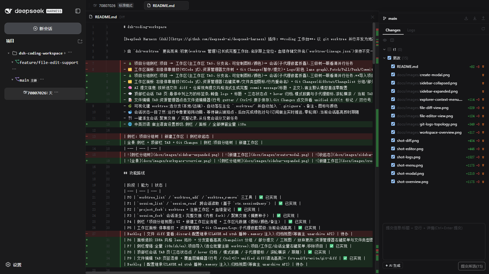
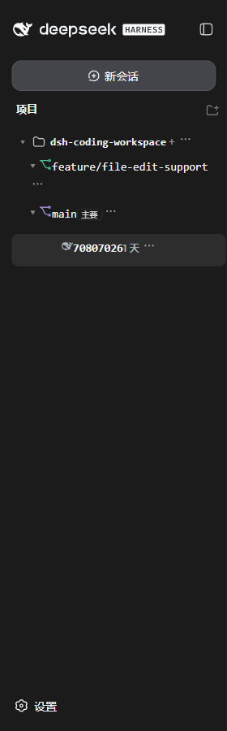
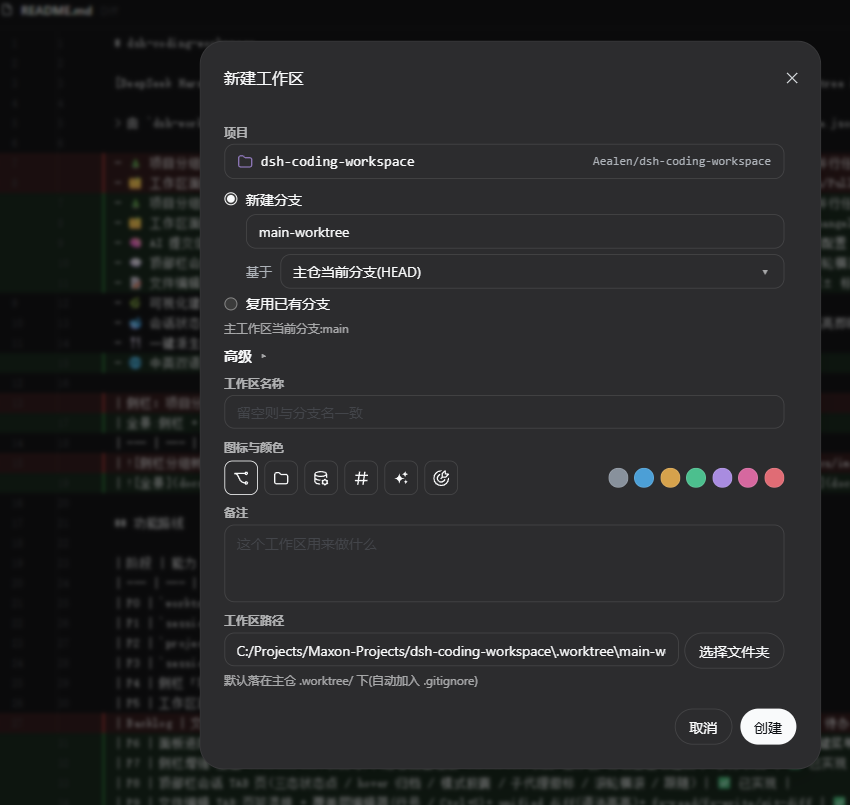
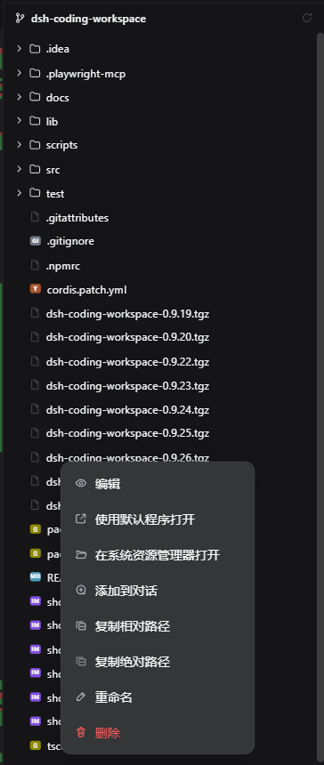
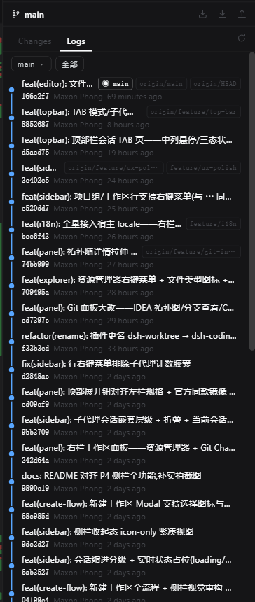
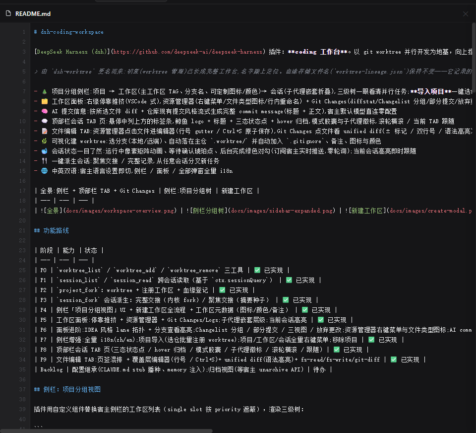
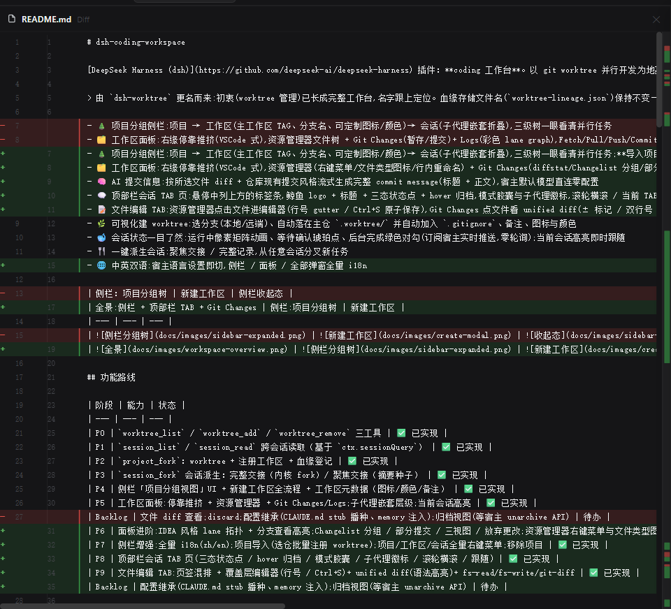

# dsh-coding-workspace

> 🌏 English documentation: [README.en.md](README.en.md)

[DeepSeek Harness (dsh)](https://github.com/deepseek-ai/deepseek-harness) 插件：**coding 工作台**。以 git worktree 并行开发为地基，向上提供**跨会话协作**原语、**项目分组侧栏**与**停靠式工作区面板**(资源管理器 / Git Changes·Logs),把 dsh 的单会话界面变成多工作区并行开发驾驶舱。

> 由 `dsh-worktree` 更名而来:初衷(worktree 管理)已长成完整工作台,名字跟上定位。血缘存储文件名(`worktree-lineage.json`)保持不变——它记录的血缘对象本来就是 worktree。

- 🌲 项目分组侧栏:项目 → 工作区(主工作区 TAG、分支名、可定制图标/颜色)→ 会话(子代理嵌套折叠),三级树一眼看清并行任务;**导入项目**一键选仓,主仓 + 全部 worktree 一次性注册归组
- 🗂️ 工作区面板:右缘停靠推挤(VSCode 式),资源管理器(右键菜单/文件类型图标/行内重命名) + Git Changes(diffstat/Changelist 分组/部分提交/放弃更改)+ Logs(IDEA 风格 lane 拓扑、分支查看与高亮),Fetch/Pull/Push/Commit 一键直达
- 🧠 AI 提交信息:按所选文件 diff + 仓库现有提交风格流式生成完整 commit message(标题 + 正文),宿主默认模型直连零配置
- 🗨️ 顶部栏会话 TAB 页:悬停中列上方的标签条,鲸鱼 logo + 标题 + 三态状态点 + hover 归档,模式胶囊与子代理徽标,滚轮横滚 / 当前 TAB 跟随
- 📝 文件编辑 TAB:资源管理器双击文件进编辑器(行号 gutter / Ctrl+S / 撤回重做),Git Changes 点文件看 unified diff(± 标记 / 双行号 / 语法高亮);**行评论 Note for AI**(划选区间备注、发送到会话)、图片预览缩放平移,页签与会话 TAB 混排(中键关闭 / 归档)
- 🌿 可视化建 worktree:选分支(本地/远端)、自动落在主仓 `.worktree/` 并自动加入 `.gitignore`、备注、图标与颜色
- 🐋 会话状态一目了然:运行中像素矩阵动画、等待确认琥珀点、后台完成绿色对勾(订阅宿主实时推送,零轮询);当前会话高亮即时跟随
- 🍴 一键派生会话:聚焦交接 / 完整记录,从任意会话分叉新任务
- 🌐 中英双语:宿主语言设置即切,侧栏 / 面板 / 全部弹窗全量 i18n

| 全景:侧栏 + 顶部栏 TAB + Git Changes | 侧栏:项目分组树 | 新建工作区 |
| --- | --- | --- |
|  |  |  |

## 功能路线

| 阶段 | 能力 | 状态 |
| --- | --- | --- |
| P0 | `worktree_list` / `worktree_add` / `worktree_remove` 三工具 | ✅ 已实现 |
| P1 | `session_list` / `session_read` 跨会话读取（基于 `ctx.sessionQuery`） | ✅ 已实现 |
| P2 | `project_fork`：worktree + 注册工作区 + 血缘登记 | ✅ 已实现 |
| P3 | `session_fork` 会话派生：完整交接（内核 fork）/ 聚焦交接（摘要种子） | ✅ 已实现 |
| P4 | 侧栏「项目分组视图」UI + 新建工作区全流程 + 工作区元数据（图标/颜色/备注） | ✅ 已实现 |
| P5 | 工作区面板:停靠推挤 + 资源管理器 + Git Changes/Logs;子代理嵌套层级;当前会话高亮 | ✅ 已实现 |
| P6 | 面板进阶:IDEA 风格 lane 拓扑 + 分支查看高亮;Changelist 分组 / 部分提交 / 三视图 / 放弃更改;资源管理器右键菜单与文件类型图标;AI commit message(流式) | ✅ 已实现 |
| P7 | 侧栏增强:全量 i18n(zh/en);项目导入(选仓批量注册 worktree);项目/工作区/会话全量右键菜单;移除项目 | ✅ 已实现 |
| P8 | 顶部栏会话 TAB 页(三态状态点 / hover 归档 / 模式胶囊 / 子代理徽标 / 滚轮横滚 / 跟随) | ✅ 已实现 |
| P9 | 文件编辑 TAB:页签混排 + 覆盖层编辑器(行号 / Ctrl+S)+ unified diff(语法高亮)+ fs-read/fs-write/git-diff | ✅ 已实现 |
| Backlog | 配置继承(CLAUDE.md stub 播种、memory 注入);归档视图(等宿主 unarchive API) | 待办 |

## 侧栏：项目分组视图

插件用自定义组件替换宿主侧栏的工作区列表（single slot 按 priority 遮蔽），渲染三级树：

```
📁 demo-app            ← 项目组头（git 主仓,可折叠）
   🌿 main [主要]      ← 主工作区(分支名 + TAG,图标/颜色可定制)
   🌿 feature/login    ← worktree(备注/图标/颜色随血缘持久化)
      🐋 修复登录跳转…  ← 会话(DeepSeek 图标 + 消息摘要 + 相对时间)
   🌿 feature/payment
📁 其他工作区           ← 未归组的工作区
```

- **实时状态占位**：会话行首列显示运行中（宿主 `StateDot` 像素矩阵动画）、等待用户确认（琥珀点，审批/计划/提问）、后台完成未读（绿色对勾，打开会话后清除）。数据来自 `ctx.sessions.list` 快照（`useSyncExternalStore` 订阅宿主 mux 帧推送），不依赖轮询。
- **消息摘要**：展开工作区时懒加载（插件 HTTP 路由批量提取各会话尾部内容），比标题更直观。
- **收起态 icon 列**：侧栏收起后自动切换紧凑视图——项目组/工作区/会话各留一枚图标（运行中为绿色），同一列居中对齐；hover 保留完整 tooltip，点击行为不变。
- **两级折叠**：项目组与工作区均可收起，状态持久化（localStorage）。

### 新建工作区

侧栏项目组 `+` 打开 Modal，全流程可视化：

- **分支来源双选**：`新建分支`（新分支名 + 「基于」任意本地/远端分支，默认主仓 HEAD）/ `复用已有分支`（直选；已被其他 worktree 检出的分支自动禁选并标注）。
- **高级区**：工作区名称（留空与分支一致）、图标与颜色（6 种 icon × 7 色，与重命名 Modal 同一套）、备注、工作区路径（默认 `<主仓>/.worktree/<分支名>`，系统目录选择器一键改选）。
- 路径落在主仓 `.worktree/` 下时自动追加进主仓 `.gitignore`。
- 创建 = `git worktree add` + 注册 dsh 工作区 + 血缘登记，三步原子完成（git 失败即中止，注册失败不回滚已建 worktree，结果体分步报告）。

### 工作区管理

行内菜单：新建会话、重命名（含图标/颜色定制）、设置备注、移除工作区记录（不动磁盘目录）；右键行 = 同一菜单。备注与图标/颜色持久化在血缘边，hover tooltip 即时可见。

### 会话派生

会话行菜单「派生分支」弹 Modal 二选一：**聚焦交接**（机械摘要种子，新会话轻装上阵）/**完整对话记录**（内核 fork，完整上下文）。

### 子代理层级与高亮

宿主 `origin==='subagent'` 的会话自动嵌套到父会话名下（连接线缩进、字号降一档），父行 `▸N/▾N` 胶囊折叠；当前打开会话（含子代理）即时高亮，权威源为宿主 `useSessions` 快照 `s.current`。

### 归档过滤

归档的会话自动从分组树隐藏（数据仍完整保留）；宿主暂无 unarchive API，归档查看视图待官方接口后启用。

### 导入项目与移除

- **导入项目**：侧栏动作行「项目 · 导入」按钮（官方「新会话」正下方）→ 系统目录选择器选一个 git 仓 → 插件枚举其全部 worktree（`git worktree list --porcelain`，向上自动定位仓根），逐个注册为 dsh 工作区（宿主 `create` 幂等，bare 仓跳过）。血缘由服务端 `.git` 指针文件自动推断，注册完侧栏即按「项目 → worktree」归组。
- **移除项目**：项目组头右键「移除项目」（红色项）——仅从 dsh 列表移除该项目全部工作区**记录**，会话记录保留、磁盘目录不受影响，确认框明示。

## 工作区面板

右缘停靠(VSCode 式真推挤,窄屏自动退浮层),两个 TAB:

| 资源管理器:文件类型图标 + 右键菜单 | Logs:lane 拓扑 + 分支徽章 |
| --- | --- |
|  |  |

### 资源管理器

- 文件树懒展开,噪音目录(`.git`/`node_modules`/…)过滤;**文件类型图标**——60+ 扩展名彩色徽章(TS/JS/PY/PDF…),未识别退通用轮廓。
- **右键菜单**:使用默认程序打开 / 在系统资源管理器定位(Windows `explorer /select`) / 添加到对话(走宿主 reference 体系,输入框落蓝色引用芯片,与手动 `@` 同管线) / 复制相对·绝对路径 / 重命名(行内编辑) / 删除(红色项 + 确认)。所有写操作走工作区白名单校验,重命名新名做 Windows 保留名/非法字符全量校验。

### Git · Changes

- 文件行右列 **diffstat**:`+N -M` 加删行数(绿/红)+ 状态字母;hover 整列换操作按钮(修改文件 = 放弃更改,新文件 = 删除)。
- **Changelist 分组**:自建分组(持久化),拖拽 / 右键移动文件,提交按组勾选;平铺 / 按模块 / 按文件夹三种视图(组内二次分组,不跨 Changelist)。
- **部分提交**:勾选任意文件子集提交(含未跟踪文件),其余暂存内容不受影响。
- 提交区:**AI 生成 commit message**(SSE 流式逐字上屏,宿主默认模型直连;输出完整「标题 + 正文」,按仓库现有提交风格仿写;生成期间输入框锁定)。

### Git · Logs

- **IDEA 风格 lane 拓扑**:基于 parents 的前端建 lane 算法,整列 SVG 贝塞尔连线,列宽恒定、跨行连续;展开 commit 详情时拓扑随行高实时拉伸(实测行高 + ResizeObserver)。
- **分支查看**:下拉切任意本地/远端分支查看其提交;当前分支已有的提交高亮显示(粗略 diff,单次 `git log --not HEAD` 完成)。
- 行内展开 commit 详情(message 全文 / 作者 / 变更文件);Fetch / Pull / Push 图标按钮(Pull 仅 fast-forward;无 upstream 自动 `-u`)。

## 顶部栏:会话 TAB 页

悬停在中间对话区上方的标签条(左右边界实时对齐宿主对话列,不压侧栏与 LOGO):

- TAB = 鲸鱼 logo(激活 brand 色)+ 标题 + **三态状态点**(运行中像素动画 / 等待确认琥珀 / 完成绿勾,宿主 mux 推送零轮询)+ hover 显影红色归档钮;`+` 新建会话(工作区未登记时幂等注册再打开)。
- TAB 尾部 **模式胶囊**(标准模式等 agent preset)与**子代理计数徽标**(0 个不显示)。
- 滚轮横滚、当前 TAB 自动滚动跟随;推挤只让对话列(`_centerCol` margin-top 变量桥),侧栏不动。

## 文件编辑与 Diff

顶部栏页签**会话与文件混排**(文件页签带类型图标与脏点;中键关闭文件页签[脏确认],中键归档会话 TAB):

| 编辑器:行号 gutter + 语法高亮 + 行评论 | unified diff:± 标记 + 双行号 + 色带 |
| --- | --- |
|  |  |

- **编辑器**:资源管理器双击文件打开——行号 gutter、Ctrl+S / 浮钮保存(临时文件 + rename 原子写);自管撤回 / 重做栈(Ctrl+Z / Ctrl+Y,500ms 击键合并);二进制 / 非 UTF-8 文件拒绝进入并引导系统打开。
- **行评论(Note for AI)**:行号 gutter hover 显 `+`(VSCode 式),行级或**划选区间**备注,评论卡片内嵌行间(标题 + 文本 + 发送到会话 / 编辑 / 删除);「发送到会话」把 File/Line/User comment 格式贴进所选会话的输入框,注释随代码持久化(sidecar JSON)。
- **右键与划选菜单**:编辑 / diff 均支持右键(添加备注 / 复制 / 剪切 / 粘贴 / 全选,官方 Menu 原语);左键划选松开自动弹快捷菜单。
- **unified diff**:Git Changes 单击文件打开——`±` 标记、双行号 gutter(sticky)、全宽色带、右缘缩略状态列(点击跳转);基于 HEAD 与工作区对比,未跟踪文件显示全文新增。
- **图片预览**:图片文件(任何入口)直接进查看器——滚轮以光标为中心缩放、拖拽平移、双击适应窗口、100% 原始尺寸、透明 PNG 棋盘底衬、尺寸 / 百分比状态条;服务端 `fs-raw` 原始字节流直出。
- **语法高亮**:highlight.js 移植,逐行渲染 + 块状态机混合(块注释 / 模板串整行判定),**十二种语言**(常用开发语言 + powershell / yaml / dockerfile / dos 运维四件套),one-dark / 亮色双主题随宿主。
- Diff 核心为纯函数(`panel-diff.ts`:LCS 行对齐 + CRLF 归一 + 预算截断),独立单测覆盖。

## 国际化

侧栏 / 右栏面板 / 顶部栏 / 全部弹窗与菜单全量接入宿主 locale(`ctx.locale`),中英双语 **170+ key** 平衡;设置里切语言即时生效(slot 出口自带重渲染),宿主 locale 服务缺席时退中文兜底。

## 安装

```sh
dsh plugin --profile <profile-name> add dsh-coding-workspace
```

或手动方式：在 `$DSH_HOME/profiles/<name>/package.json` 的依赖中加入本包，并把 `dsh-coding-workspace` 追加进 `cordis.patch.yml` 的 insert 列表（本仓库根已附带现成的 patch 文件）。

## 开发

```sh
npm install
npm run typecheck   # tsc --noEmit
npm run build       # 输出到 lib/
npm test            # 单测（node --test）
```

## 工具说明

### worktree_list

枚举仓库全部 worktree。参数：

- `repoPath`（可选）：仓库路径，默认当前工作目录。

### worktree_add

创建新 worktree。参数：

- `path`（必填）：新 worktree 目录。
- `branch`（必填）：分支名；`createBranch=true` 时为新建分支名。
- `createBranch`（可选，默认 true）：是否新建分支并检出。
- `baseRef`（可选）：新建分支时的起点（commit/分支/tag）。
- `repoPath`（可选）：源仓库路径。

### worktree_remove

删除 worktree。存在未提交内容时需显式 `force=true`。参数：

- `path`（必填）：worktree 目录。
- `force`（可选）：丢弃未提交内容强制删除。
- `repoPath`（可选）：源仓库路径。

### session_fork

从源会话派生新会话,并在 `~/.dsh/session-lineage.json` 登记父子边。参数:

- `sourceSessionId`（必填）：源会话。
- `mode`：`full`（默认,完整交接——内核 `SessionStore.fork`,与 Web UI 消息分支按钮同路径）/ `focus`（聚焦交接）。
- `summary`：`focus` 模式必填——先用 `session_read` 读源会话,提炼摘要传入,作为新会话的首条种子消息。
- `boundary`：`full` 模式可选,事件 seq 锚点(缺省回退到最后一个完成 turn)。
- `newSessionId`：可选自定义子会话 id。

### session_list

列出 harness 最近会话(含历史持久化)。参数:`limit`(默认 20)、`cwdContains`(按工作目录过滤)。

### session_read

读取一个会话内容。参数:`sessionId` 必填、`mode`(`tail` 默认末尾窗口 / `full` 全部)、`maxChars`(默认 12000)。只读,不唤醒源会话。依赖 profile 提供 sessionQuery 服务,缺席时报可读错误。

### project_fork

fork 项目三连:git worktree(新分支)→ 注册进 dsh 工作区 → 血缘登记(分组视图数据源)。参数:`name` 必填(兼作分支名)、`sourceRepoPath`、`worktreePath`、`baseRef`、`title`。注册/血缘失败不拆除已建 worktree,结果体如实分步报告。

## HTTP 路由（侧栏 UI 后端）

| 路由 | 作用 |
| --- | --- |
| `POST /dsh-coding-workspace/repo-info` | 分支清单（本地/各远端）+ 当前分支 + 被占用分支 + origin 短名 |
| `POST /dsh-coding-workspace/worktree-create` | `git worktree add` 全链路 + 注册 + 血缘（含备注/图标/颜色） |
| `POST /dsh-coding-workspace/workspace-note` | 工作区元数据写回（备注/图标/颜色，空串清除） |
| `POST /dsh-coding-workspace/lineage` | 批量读取工作区血缘（分组/分支名/元数据展示） |
| `POST /dsh-coding-workspace/session-summaries` | 会话消息摘要批量懒加载（尾部窗口提取） |
| `POST /dsh-coding-workspace/session-fork` | 会话派生（聚焦交接 / 完整记录），供侧栏动作调用 |
| `POST /dsh-coding-workspace/fs-list` | 面板·资源管理器目录清单（懒展开，目录穿越防护 + 噪音目录过滤） |
| `POST /dsh-coding-workspace/fs-action` | 资源管理器写操作：open / reveal / delete / rename（系统调用 spawn 无 shell，confirm 显式确认） |
| `POST /dsh-coding-workspace/fs-read` | 编辑器读文件（二进制 / 非 UTF-8 探测拒绝，无大小上限） |
| `POST /dsh-coding-workspace/fs-write` | 编辑器保存（临时文件 + rename 原子写） |
| `GET  /dsh-coding-workspace/fs-raw` | 图片原始字节流直出（预览；扩展名双校验 + 50MB 护栏） |
| `POST /dsh-coding-workspace/line-notes` | 行评论持久化（list / add / update / delete，行级与区间） |
| `POST /dsh-coding-workspace/git-overview` | 面板·分支 / upstream / ahead / behind（非 git 仓返回 isRepo=false） |
| `POST /dsh-coding-workspace/git-status` | 面板·Changes 三组（staged / unstaged / untracked）+ 每文件增删行数（numstat / untracked 数行） |
| `POST /dsh-coding-workspace/git-log` | 面板·Logs（`%H…%P` 行协议，前端建 lane 拓扑；分支查看模式含独有提交集） |
| `POST /dsh-coding-workspace/git-show` | 面板·commit 详情（元信息 + 变更文件，hash 白名单校验） |
| `POST /dsh-coding-workspace/git-diff` | 文件 diff（base=HEAD；untracked 左空右全文；LCS 前端对齐） |
| `POST /dsh-coding-workspace/git-action` | 面板·写操作唯一入口（stage/unstage/commit(部分提交)/fetch/pull/push/rollback 白名单） |
| `POST /dsh-coding-workspace/git-changelist` | Changelist 分组持久化（list / create / delete / move,支持批量拖拽移动） |
| `POST /dsh-coding-workspace/git-worktrees` | 项目导入·枚举 git 仓全部 worktree（只读，向上定位仓根，cap 50） |
| `POST /dsh-coding-workspace/ai-commit-msg` | AI 提交信息生成（宿主 LlmRuntime 流式，SSE 逐段推送） |

## 设计备忘

- 本插件不修改 dsh 主仓任何行为，纯增量挂载（Cordis 微内核扩展点机制）。
- 工作区面板挂 `shell.overlay`（官方点名的 additive 浮层 list slot）；**停靠推挤**用「CSS 变量桥」——面板展开写 `--dsh-coding-workspace-panel-width`，注入 `#root { margin-right: var(...) }` 让宿主让位，不碰宿主 inline style；检测到 better-sidebar 类冲突插件自动退回纯浮层。
- 血缘关系（worktree ←→ 源仓库）当前持久化在 harness home 的 `worktree-lineage.json`（原子写，接口收窄可替换为 `ctx.storage` KV form）。设计取舍见 docs/plan-P1-P2.md。
- 会话按 `cwd` 归属到工作区（`workspaceIds` 仅为兜底），不依赖 attach 时序；归档集合来自 `workspace.list` 的 registry-global 数据。
- 执行 git 一律走 `child_process` 直连并遵守工具取消信号（`exec.signal`），不经 shell 服务，行为可预测；Windows 下对 git 可执行文件做绝对路径探测（`where` → 注册表 → 常见位置），规避「相对命令名 + cwd」触发的 `ENOENT`。
- 侧栏组件订阅宿主 `sessions.list` 快照（ObservableSnapshot + `useSyncExternalStore`）获取实时 running/completed 状态，10s 轮询仅为树结构兜底刷新。
- 顶部栏同样挂 `shell.overlay`（第二枚 entry），但推挤只让对话列——`[class*="_centerCol"] { margin-top: var(--dsh-coding-workspace-topbar-h) }`，不动 `#root`（否则侧栏一起被压）；边界用 ResizeObserver 实测宿主对话列位置，随侧栏拖宽 / 面板开合实时跟随。
- i18n 走宿主 `ctx.locale`（dsh-client-locale）：register/bind 即接入，slot 出口自带 locale revision 订阅，切语言整树自动重渲染；**cordis 第三方服务必须在 entry inject 声明**——未声明的服务连 `ctx.get` 都抛 without inject，漏声明时 t 会静默退兜底语言。
- 插件自有文案集中在 `locales.ts`（zh/en 字典,key 集双向平衡由脚本校验），组件统一 `t(key, params)`;宿主 locale 服务缺席退中文兜底,面板不因 i18n 挂载失败。
